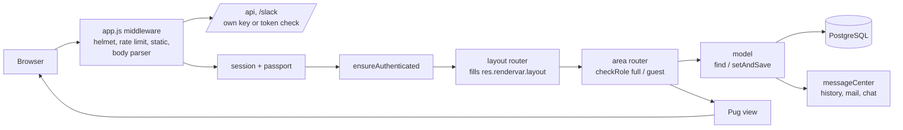
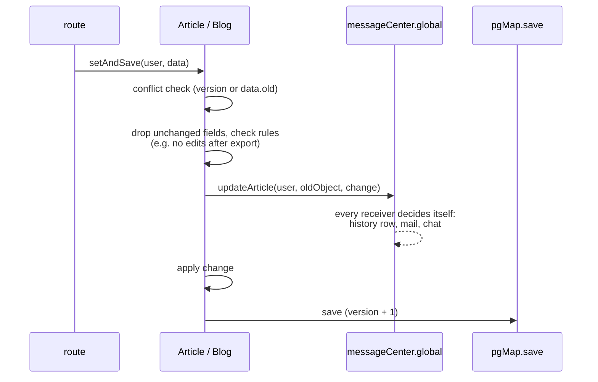

# Architecture

How OSMBC is built and why. This page is the map: read it before you
change code you don't know yet. Details live in the linked documents and
in the code; this page tells you where to look and which rules hold
everywhere.

OSMBC is a single Node.js process (Express, server-side rendered Pug
views, a little jQuery in the browser) on top of one PostgreSQL database.
There is no build step, no front-end framework and no separate API
server: the HTML pages and the JSON API come from the same app.

## Directory map

| Directory | What is in it |
|---|---|
| `bin/www.js` | process start: Node version check, HTTP(S) server, module initialisation |
| `app.js` | Express app: security headers, static files, session, login, route mounting, error page |
| `config.js` | the **technical** configuration from `config.<NODE_ENV>.yaml` (see below) |
| `routes/` | one Express router per area (`article`, `blog`, `users`, `config`, `api`, `slack`, `wiki` …) |
| `model/` | the domain objects (`Article`, `Blog`, `User`, `Config`) and their persistence (`pgMap.js`, `db.js`) |
| `notification/` | everything that reacts to a change: change history, mail, Mattermost/Slack, export log |
| `render/` | turns a blog into HTML, Markdown or Hugo Markdown (export targets) |
| `util/` | shared helpers (markdown setup, link checks, SSRF-safe HTTP agents, config split …) |
| `wiki/` | the optional editorial wiki (git-backed Markdown pages) |
| `views/` | Pug templates; `layout.pug` is the frame every page extends |
| `public/` | static files; `public/javascripts/` holds the browser code (jQuery, no bundler) |
| `help/` | user help pages (Markdown), shown inside the app |
| `data/` | default contents for the editorial configs stored in the DB (see below) |
| `wp-reconcile/` | migration tools from WordPress (temporary, removed after the final reconciliation) |
| `export/`, `import/`, `genstaticpage/` | small command-line and generation tools |
| `test/` | mocha tests, Selenium UI tests (`uc.*`) and their page objects |
| `tools/` | maintenance scripts for developers (test wrapper, coverage check, migrations) |

## Startup

`bin/www.js` is the entry point. It

1. refuses to run on a Node version that is too old,
2. imports `app.js`, which builds the Express app (importing `config.js`
   reads the YAML config right away and fails fast on missing keys),
3. initialises the modules in dependency order (`async.auto`): the DB
   configs (`model/config.js`), the message center with its receivers,
   mail and Mattermost receivers for all users, and — unless
   `Transition.enabled` is false — the scheduler for automatic blog
   transitions (`model/blogTransitionScheduler.js`),
4. only then starts listening.

Tests use the same initialisation through `util/initialise.js`.

## A request, end to end

* `/api` and `/slack` are mounted **before** the session: they are called
  by machines and check their own API key or token.
* Everything else needs a logged-in user. `routes/auth.js` handles login
  (OpenStreetMap OAuth 2, optionally htpasswd) and `ensureAuthenticated`
  redirects to `/login` otherwise.
* `routes/layout.js` does not render anything. It prepares the data the
  frame needs (`res.rendervar.layout`: user, current blogs, menus) so every
  view can extend `layout.pug`.
* Access rights are per route with `auth.checkRole("full")` or
  `checkRole(["full", "guest"], …)`. Users have `access` `full`, `guest`
  or `denied`. For guests the second argument of `checkRole` adds a
  check: in `routes/article.js` (`requireOpenForGuest`) a guest may only
  open and comment on articles they collected or are mentioned in
  (`Article.isOpenForGuest`).
* Routers load the object named in the URL with `router.param`
  (e.g. `getArticleFromID` for `:article_id`) and hand it to the handler
  in `req`.

## Data and persistence

* Every table (`article`, `blog`, `usert`, `config`, `changes`,
  `session`, `link`) is `id` + one `jsonb` column `data`. There are no typed
  columns. A field is queried as `data->>'field'`
  (e.g. `data->>'categoryEN'`).
* The user table is called `usert`, not `users`.
* There are no foreign keys between the tables, so a table can be
  truncated or reloaded on its own without ordering constraints.
* `blog.categories` is an ordered array. Its order decides the order of
  the headings in the rendered blog **and** the position of the
  lead-picture caption. When you reorder, do it relative to an existing
  category, never by absolute index 0.
* `model/pgMap.js` is the only place that talks SQL for these objects.
  The model classes borrow its functions (`Article.prototype.save =
  pgMap.save`, `find`, `findById`, `findOne`, `fullTextSearch`), and
  `find` takes a small query object (`{ status: "open" }`,
  `{ access: "IN(full,guest)" }`, `"!="`, `">="` …) that `generateQuery`
  turns into SQL with parameters.
* Every object has a `version`. `save` increases it and refuses to
  overwrite a newer version in the DB ("Version Number Differs"). This is
  how two editors working on the same article don't silently overwrite
  each other.

Why jsonb: it let the data model grow field by field without migrations
(per-language fields like `markdownDE`, `markdownEN` …). The price is no
type checks and no referential integrity in the DB; the model code is
responsible for both.

## Changing an object: `setAndSave`

Editorial changes never call `save()` directly. They go through
`setAndSave(user, data, callback)` on `Article` or `Blog`:

* **Conflict check.** The form sends either the `version` it was loaded
  with, or for single fields the old value (`data.old`). If the DB holds a
  different value, the change is refused with HTTP 409 and the editor
  sees both values.
* **Broadcast before save.** The message center gets the old object and
  the change. It forwards it to *every* registered receiver; it filters
  nothing itself.
* **Service users.** Changes OSMBC makes itself are saved under a
  service user instead of a person: `deeplPro API Call` (DeepL),
  `ClaudeAI` (First Draft), the migration / API key users,
  `wp-oldimport`. They show in the history like everybody else.
  `model/serviceUsers.js` maps each name to its function; evaluations use
  it to tell them from editors (today the credits of an issue; the others
  follow with issue #1186).

### Receivers

`notification/messageCenter.js` has one global instance,
`messageCenter.global`. `setAndSave`, `closeLanguage` and the other mutating
functions call one of its eight methods: `sendInfo`, `updateArticle`,
`updateBlog`, `sendReviewStatus`, `sendCloseStatus`, `sendCloseBlocked`
(Auto Close could not close a reviewed language), `addComment`,
`editComment`. Registered today:

* `LogModuleReceiver` — writes the `changes` table behind the "History"
  tabs, wrapped in a `FilterReceiver` (see below),
* `ExportReceiver` — text log for operational markers such as exports,
* via `IteratorReceiver`, one `MailReceiver` per user and one
  `SlackReceiver` per Mattermost/Slack channel, each wrapped in filters
  for the user's or channel's notification settings.

Rules:

* **Every receiver implements all eight methods.** The message center
  calls them without checking whether they exist; a missing one throws as
  soon as that event happens. Use no-op stubs for events a receiver
  doesn't care about (see `notification/exportReceiver.js`). The list is
  `RECEIVER_METHODS` in `notification/FilterReceiver.js`;
  `test/notification.receiverMethods.test.js` checks every receiver
  class against it — add a new receiver class there.
* **Errors.** The message center gives every event to all receivers and
  calls back with the first error. `IteratorReceiver` (mails, channels,
  direct messages) is fire and forget: it calls back at once, so saving
  does not wait for mails and webhooks, and only logs a failing receiver
  (showing those in the admin UI: issue #1182).
* **Each receiver decides itself whether a change is relevant.** This is
  not uniform: `UserConfigFilter` (mail per user) looks at
  `change.status`, `LogModuleReceiver` on its own logs every field it
  gets. So an unfiltered receiver turns *every* field change into a
  history row that editors see.
* `notification/FilterReceiver.js` is the reusable wrapper that puts a
  relevance check in front of a receiver. `messageCenter.js` uses it to
  keep purely operational blog fields (`exportedBy`, `autoTranslated`)
  out of the history.
* **A field that should stay invisible to editors still goes through
  `setAndSave`.** Never reach for a bare `save()` to avoid the broadcast;
  add a filter instead. Otherwise the version check, the change rules and
  every other receiver are bypassed too.

## Checking input: in the model

The database accepts any field (`jsonb`, no schema, no foreign keys), and
the web UI is not the only caller: any logged-in user can send any
request, and the API, the transition scheduler and the blog sync call the
model without a UI. So the model is the only place where a wrong value
can be stopped for every caller, even where today's UI never sends it.

* **Public model methods check inputs that are saved or become part of a
  field name** — language ids (`"close" + lang`), status values, ids,
  action names. Internal helpers may rely on that check.
* **A caller's mistake is an error with `status`, returned through the
  callback before anything is broadcast or saved**: 400 (`BAD_REQUEST`)
  for an invalid value, 409 (`CONFLICT`) for a state that forbids the
  action. Example: `Blog.setAndSave` refuses an unknown blog status. The
  error handler in `app.js` turns `err.status` into the HTTP status, so a
  route only needs code of its own when the UI must show the message
  differently (e.g. the 409 text for the close button).
* **`assert` is for programming errors only** (a wrong type from our own
  code). A value that can come from a request is not one: an `assert`
  there becomes a 500 and hides the real cause.
* **Not in the model:** access rights and the form of the answer stay in
  the route.
* Older code does not follow this everywhere. Add the check when you
  touch a method anyway.

## Two kinds of configuration

| | Technical config | Editorial config |
|---|---|---|
| Where | `config.<NODE_ENV>.yaml` (optionally split, see `editorial_config`) | table `config`, edited in the app under Admin |
| Read by | `config.js`, `config.getValue(key, { mustExist })` | `model/config.js`, `configModule.getConfig(name)` |
| Examples | DB connection, URL, login, export profiles, languages, API keys | votes, category translations, calendar texts, help menu, First Draft prompt |
| Changes | restart needed | live |

The defaults for the editorial configs are in `data/` and are copied into
the DB the first time a config is missing. After that the DB is the
truth. Field reference: [config.md](config.md).

## Blog lifecycle and languages

A blog (one issue) has a `status` of `open` (collecting), `edit`
(editing), `closed` (published) or `trash`. On top of that each language
has its own review, export and close state (`reviewCommentXX`,
`exportedXX`, `closeXX`). Several transitions can run automatically by
time (`Transition` in the config, see [config.md](config.md)
"Automatic transitions").

Languages are configured in `languages`. Every per-language text is a
field with the language code as suffix (`markdownDE` on the article,
`exportedEN`, `closeEN` on the blog …), so a
language id must never be renamed once it holds data.

### Text status of an article: one rule

Whether a text counts as written is decided in one place:
`Article.textStatus(lang)` in `model/article.js` returns `unpublished`
(not counted), `noTranslation`, `unwritten` (no text yet, or still in
`-- no category yet --`) or `written`. Everything that counts or selects
texts uses it:

* the blog's status counts (`Blog.calculateStatus`: `getUnEdited`,
  `getWritten`, `getExpected`, `getNoTranslate`) and the automated
  translation count (`Blog.calculateAutoTranslate`), shown in the menu
  bar, the start page status table, the blog header and the blog list;
* the article list filters `writtenLang` / `unwrittenLang`
  (`routes/article.js`), the targets of the start page table links — so
  the number on a badge and the length of the list behind it match.

Rules for changes:

* Change the rule in `textStatus` only, never in a caller.
* A second implementation of the same rule (e.g. a SQL query that counts
  without loading the articles) is listed here with its file, and a test
  compares its result with `textStatus` on the same data (as
  `test/model.navbarBlogs.test.js` does for the cached counts). Both are
  changed in the same commit.

The same applies to the inbox mentions (`Blog.mentionsFor`, rule in
`mentionKind` in `model/blog.js`: a direct mention of the user wins, then
the main language or `@all`, then the second language).

### Menu bar data is cached

`routes/layout.js` runs for every page and shows the TBC, open and edit
blogs with their counts. `model/navbarBlogs.js` keeps them with the part
of the derived data that is the same for every user; the user's mentions
come from `Blog.mentionsFor` per request. The cache is dropped after every
write to `article`, `blog` or `changes` in the process
(`model/tableWrites.js`, reported by `pgMap.save`/`remove`/`createTables`
and `logModule.log`) and after 60 seconds at the latest, for writes by
another process. Code that writes these tables with its own SQL must call
`reportTableWrite`. The cached blogs and articles are shared between
requests: read only, never save them.

## Output: rendering and export

`render/BlogRenderer.js` `createRenderer(type, blog)` returns the
renderer for an export profile: `HtmlRenderer` (preview and WordPress),
`MarkdownRenderer`, `HugoMarkdownRenderer`. They share the base class
`render/Renderer.js`; `HtmlRenderer` has an editor and a production
target (`rendererOptions`). Which profile uses which renderer, and what the
fields mean: [export-profiles.md](export-profiles.md),
[hugo-export.md](hugo-export.md). External callers get the result through
the API: [API.md](API.md).

Markdown inside articles is rendered on the server with markdown-it plus
a few plugins (`util/md_util.js`, own copies in `util/markdown-it-*.js`).
The live preview in the browser uses markdown-it and the npm versions of
the same plugins (copied by `postinstall.js`), so both outputs can differ
in details.

## Browser code

The views are rendered on the server. `public/javascripts/` adds
behaviour with jQuery and Bootstrap 5: live preview, link checks,
voting, saving single fields. There is no bundler; the files are served
as they are. Libraries from npm are copied into `public/` by
`postinstall.js`.

Rules for every UI change (mobile mode, tap targets, no inline event
handlers …): [ui-guidelines.md](ui-guidelines.md).

## Code conventions you will meet

* **Callbacks and promises.** Most model functions are written with
  Node callbacks (`function (err, result)`) and the `async` library. Many
  of them also return a promise when called without a callback. New code
  may use `async`/`await`; keep the callback signature where existing
  callers need it.
* **`debug` instead of `console.log`.** Every module has
  `const debug = _debug("OSMBC:<area>:<module>")`. Start with
  `DEBUG=OSMBC:* npm start` (or a narrower pattern) to see it.
  Operational messages go to `config.logger` (winston).
* **ES modules** (`"type": "module"`), relative imports with `.js`
  extension.
* **Readability limits** checked by ESLint (function size, complexity,
  JSDoc on exports): [development.md](development.md) "Lint rules for
  readability".
* **Commit messages** in Conventional Commits format:
  [CONTRIBUTING.md](../CONTRIBUTING.md).

## Where to start for a change

| You want to … | Start in |
|---|---|
| add a field to articles | `model/article.js` (rules in `setAndSave`, `isChangeAllowed`), the view in `views/article/`, `public/javascripts/article_view.js` |
| change what a page shows | the route in `routes/<area>.js` (which data it passes), then the Pug view |
| change who may do something | the `checkRole` on the route in `routes/<area>.js` |
| react to a change (new notification) | a new receiver in `notification/`, registered in `messageCenter.js` or `mailReceiver.js` / `slackReceiver.js` |
| change the exported blog | `render/` and the export profile in the config |
| add an editorial setting | a default in `data/`, an entry in `checkAndRepair` in `model/config.js` |
| add a technical setting | `config.js` (`getValue`), document it in [config.md](config.md) |
| add an API endpoint | `routes/api.js`, document it in [API.md](API.md) |
| correct data in many closed issues at once | a script against the blogSync API, starting from `tools/dataAdminTemplate.py` ([API.md](API.md#bulk-corrections-through-the-api-data-admin)) |
| test it | [development.md](development.md) "Tests"; UI tests only through `test/PageObjectModel/` |

## Further reading

* [development.md](development.md) — local setup, tests, coverage, releases
* [install.md](install.md) — running OSMBC on a server
* [config.md](config.md) — every configuration key
* [ui-guidelines.md](ui-guidelines.md) — rules for views and browser code
* [wiki.md](wiki.md) — the editorial wiki
* [API.md](API.md), [export-profiles.md](export-profiles.md), [hugo-export.md](hugo-export.md)
